<div align="center">

# 🌱 Daily Hub

**Your whole day in one Android app: pure-veg diet, gym, steps, money, habits, smoking and to-dos.**
No account, no ads, no server. Everything stays on your phone.

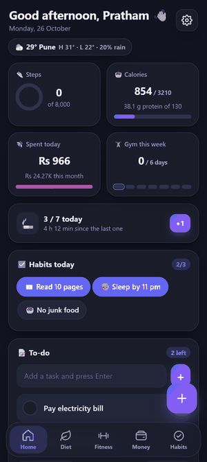

</div>

---

## Contents

- [What it does](#what-it-does)
- [Screenshots](#screenshots)
- [Install it on your phone](#install-it-on-your-phone)
- [First-time setup checklist](#first-time-setup-checklist)
- [How to use each section](#how-to-use-each-section)
- [Backup and moving to a new phone](#backup-and-moving-to-a-new-phone)
- [Privacy](#privacy)
- [Build it yourself (for developers)](#build-it-yourself-for-developers)
- [How the app is put together](#how-the-app-is-put-together)
- [Where the data comes from](#where-the-data-comes-from)
- [FAQ](#faq)
- [Known limits](#known-limits)

---

## What it does

| Section | What you can do |
|---|---|
| 🏠 **Home** | Greeting, weather for your city, today at a glance (steps, calories, spends, gym days), habit chips, to-do list, focus timer and notes. |
| 🥗 **Diet** | Log meals from 327 pure-veg Indian foods (search in English or Hindi: *rajma, atta, chawal, badam*). See calories, protein, carbs and fat against your goal. Track water. Get pure-veg meal ideas sized to what is left of your day. |
| 🏋️ **Fitness → Gym** | Start a workout from a plan (Push, Pull, Legs and more) or pick from 873 exercises grouped by muscle: Chest, Back, Biceps, Triceps, Shoulders, Legs, Abs. Each exercise has a moving demo. Log kg × reps, reps only (push-ups, pull-ups) or seconds (plank). Rest timer, new-PR celebration, sets per muscle each week, calories burned. |
| 👟 **Fitness → Steps** | Reads your steps, distance and active calories from Health Connect. Daily ring, 7-day chart, streaks. |
| ⚖️ **Fitness → Body** | Weight log with a trend line and BMI. |
| 💰 **Money** | Log spends in Rs, monthly budget, category split, day-by-day chart, monthly bill reminders, export to Excel (CSV). |
| ✅ **Habits** | Daily habits with streaks and a 12-week calendar. |
| 🚬 **Smoking** | One-tap +1, daily limit, time since the last one, weekly trend and money spent. Optional plan that lowers your limit by one every week. |
| ⚙️ **Settings** | 8 colour themes, light / dark / pure black, goals, reminders, switch off any section you do not use, backup and restore. |

Any section you do not need can be switched off in **Settings → Features**, and it disappears from the app.

---

## Screenshots

<table>
  <tr>
    <td align="center">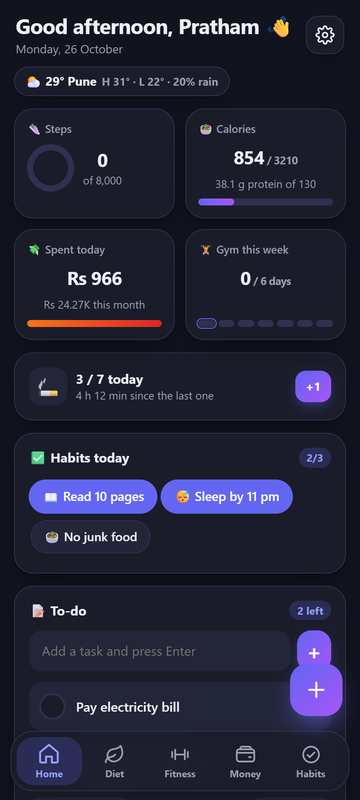<br/><sub>Home (dark)</sub></td>
    <td align="center">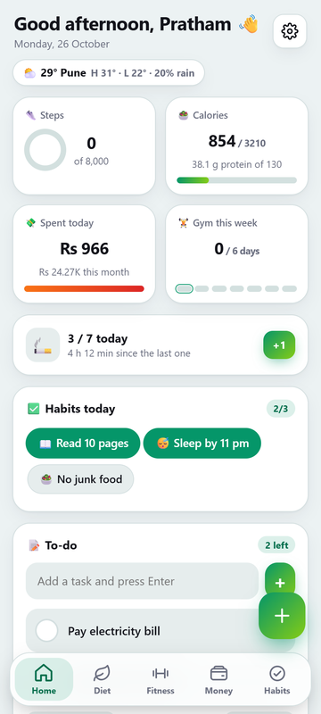<br/><sub>Home (light, Forest theme)</sub></td>
    <td align="center">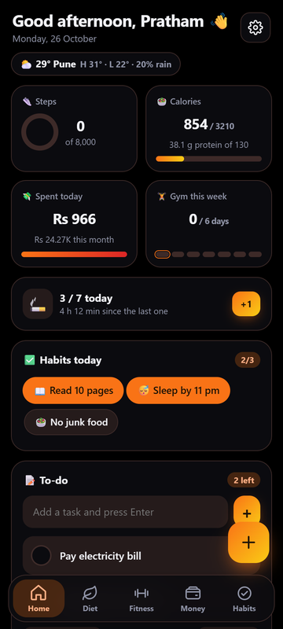<br/><sub>Home (black, Saffron theme)</sub></td>
  </tr>
  <tr>
    <td align="center">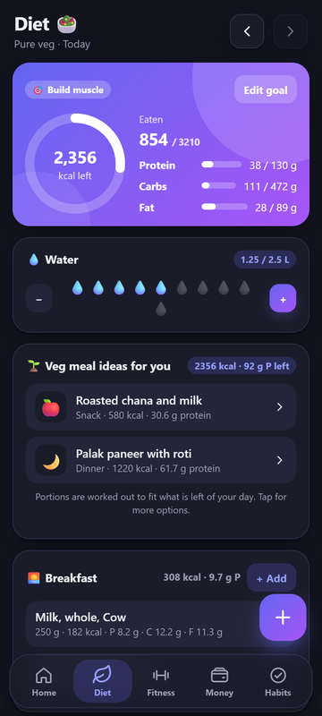<br/><sub>Diet: goal, macros, water</sub></td>
    <td align="center">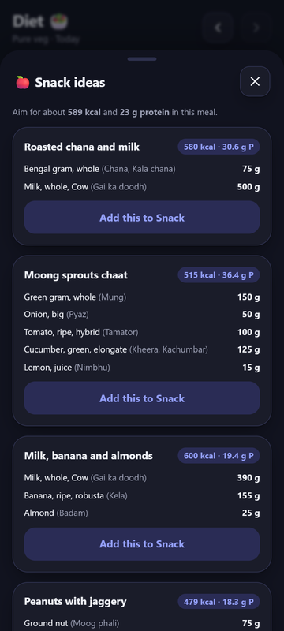<br/><sub>Pure-veg meal ideas</sub></td>
    <td align="center">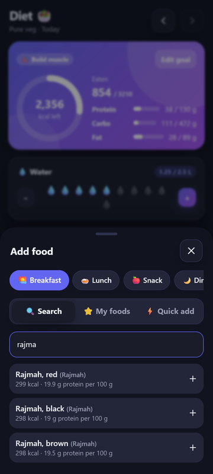<br/><sub>Food search (Hindi names work)</sub></td>
  </tr>
  <tr>
    <td align="center">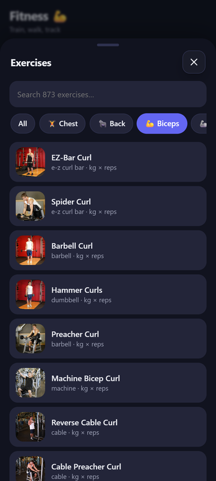<br/><sub>Exercises by muscle</sub></td>
    <td align="center">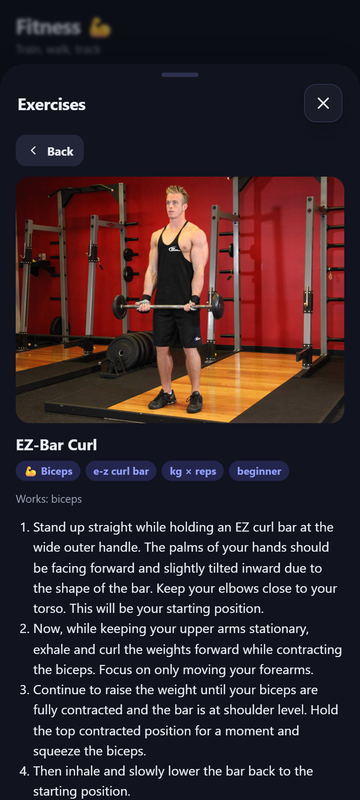<br/><sub>Moving demo + steps</sub></td>
    <td align="center">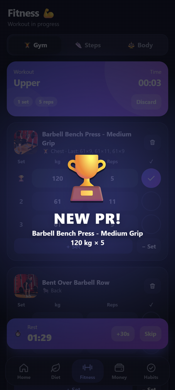<br/><sub>New personal record</sub></td>
  </tr>
  <tr>
    <td align="center">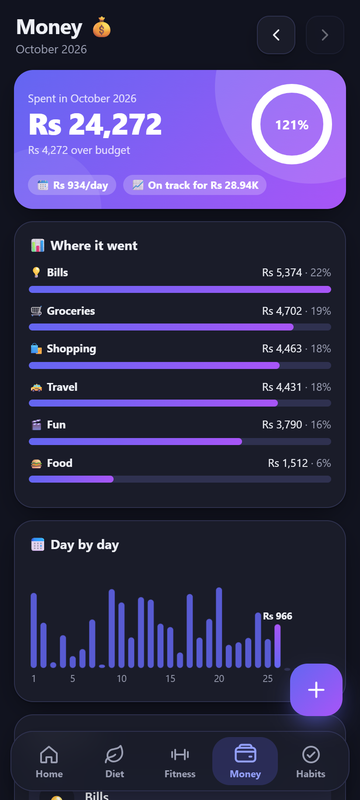<br/><sub>Money</sub></td>
    <td align="center">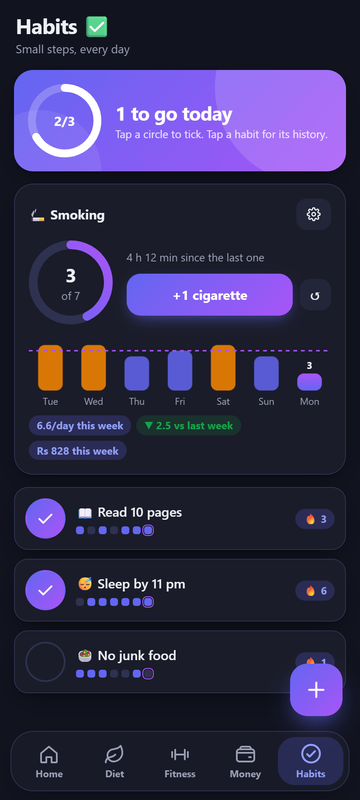<br/><sub>Habits and smoking</sub></td>
    <td align="center">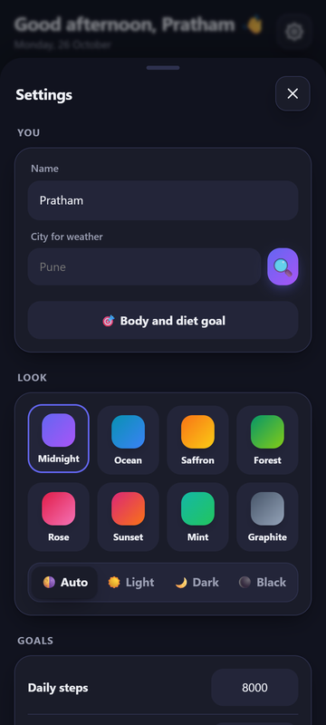<br/><sub>Settings and themes</sub></td>
  </tr>
</table>

<sub>Screenshots use made-up demo data.</sub>

---

## Install it on your phone

You need an Android phone with **Android 8.0 or newer**. Steps work best on Android 14 or newer, where Health Connect is built in.

### Option 1: Install the ready APK (easiest)

1. On your phone, open the [**Releases**](https://github.com/pratham550/Daily_tracker/releases/latest) page of this repository and download the file named `DailyHub-*.apk`.
2. Open the downloaded file from the notification or from the **Files** app.
3. Android will say the browser or Files app is not allowed to install apps. Tap **Settings**, turn on **Allow from this source**, then go back.
4. Tap **Install**. If **Google Play Protect** shows a warning about an unknown app, tap **More details → Install anyway**. This warning comes up for any app that is not from the Play Store.
5. Open **Daily Hub** from your app drawer.

> **Kindly note:** if the Releases page is empty, no APK has been published yet. Use Option 2 or ask the owner of this repository for the APK file.

### Option 2: Build the APK yourself

See [Build it yourself](#build-it-yourself-for-developers). It takes about 15 minutes the first time, mostly downloads.

### Updating to a newer version

Install the new APK over the old one. Your data stays. If Android refuses because the signature is different, take a backup first (Settings → Backup), uninstall, install the new APK and restore the backup.

---

## First-time setup checklist

Tick these off once. Each one takes under a minute.

- [ ] **Name and theme.** The app asks for these on first launch. You can change the theme any time in ⚙️ Settings.
- [ ] **City for weather** (optional). Settings → You → City.
- [ ] **Diet goal.** Diet tab → *Set up in 30 seconds*. Enter age, height, weight, how active you are, and your goal (lose fat, stay fit, build muscle). The app works out daily calories and protein.
- [ ] **Steps.** Fitness → Steps → *Connect Health Connect* → allow **Steps**, **Distance** and **Active calories**.
- [ ] **Reminders.** Settings → Reminders. Turn on what you want (water, habits, gym, meals, bills). Allow notifications when Android asks.
- [ ] **Exact timing for reminders.** If Settings shows *Allow exact timing*, tap it and allow. Without this, Android may deliver reminders a few minutes late.
- [ ] **Test it.** Settings → Reminders → *Test (in 1 min)*. Close the app. A notification should arrive in about a minute.
- [ ] **First backup.** Settings → Backup → *Save backup* → save it to Google Drive.

---

## How to use each section

<details>
<summary><b>🏠 Home</b></summary>

- Tap any of the four tiles to jump to that section.
- **To-do:** type a task and press Enter. Swipe a task **right** to finish it, **left** to delete it. Every delete has an **Undo** button for a few seconds.
- **Habits today:** tap a chip to tick it.
- **Focus timer:** pick 25 minutes or a 5 minute break and tap Start. You get a notification when it ends, even if the app is closed.
- The round **+** button at the bottom right opens a quick-add menu from anywhere on Home.
</details>

<details>
<summary><b>🥗 Diet</b></summary>

- **Add food:** tap **+ Add** on a meal (or the round + button). Search by English or Hindi name, pick the grams (chips for 25 / 50 / 100 / 150 / 200 g, or type any number) and add.
- **Grams are for the raw food**, as in the food tables. For example, 60 g of atta makes about two rotis.
- **My foods:** curd, oats, soya chunks, tofu and whey are not in the Indian food tables. Add them once from the packet label (per 100 g or per serving). After that they work like any other food.
- **Quick add:** eating out and only know the calories? Use Quick add.
- **Same as yesterday:** an empty meal shows a button to copy yesterday's meal.
- **Veg meal ideas:** the app looks at what is left of today's calories and protein, splits it across the meals you have not logged yet, and suggests pure-veg meals with exact grams. Tap one to see more ideas, then **Add this** to log it in one go.
- **Water:** tap + for each glass. Glass size is in Settings.
- Swipe a logged item **left** to remove it.
</details>

<details>
<summary><b>🏋️ Fitness</b></summary>

**Gym**

1. Tap a plan (Push, Pull, Legs, Upper, Lower, Full body) or **Empty**.
2. For each set, type kg and reps (or reps only, or seconds, depending on the exercise) and tap the ✓ circle.
3. Ticking a set starts the **rest timer**. You get a notification when rest is over.
4. Beat your best for an exercise and you get a 🏆 **NEW PR** celebration on the spot.
5. Tap **Finish workout** to save. You see time, sets, reps, calories and any new records.

- **📚 Exercises:** browse 873 exercises by muscle group. Tap the picture to see the moving demo and step-by-step instructions.
- **📈 Progress:** 12-week calendar, all personal records and full workout history.
- **✏️ Plans:** edit the plans or make your own, one exercise per line.
- Sets are pre-filled with what you did last time, so usually you only adjust and tick.

**Steps:** connect once, then it syncs by itself whenever you open the app.

**Body:** log your weight each morning. One entry per day.
</details>

<details>
<summary><b>💰 Money</b></summary>

- Tap **+** and enter the amount, pick a category, add a note if you like.
- The top card shows the month's total, how much budget is left, your daily average and where you are heading by month end.
- **Bills:** add rent, EMI, phone and so on with a due day (1 to 28). You get a reminder at 9 am on that day.
- **Export:** the button at the bottom shares the month as a CSV file that opens in Excel.
- Use the arrows at the top to see earlier months.
</details>

<details>
<summary><b>✅ Habits and 🚬 smoking</b></summary>

- Tap the big circle to tick a habit for today. 🔥 shows your current streak.
- Tap the habit name for its 12-week calendar, best streak and 30-day percentage.
- **Smoking:** tap **+1 cigarette** each time. The ⚙️ on the card sets a daily limit, price per cigarette, and an optional plan that lowers the limit by one each week. Days over the limit show in amber.
- Free help to quit: National Tobacco Quitline, Government of India, **1800-11-2356**.
</details>

<details>
<summary><b>⚙️ Settings</b></summary>

- **Look:** 8 themes and 4 modes (Auto, Light, Dark, Black).
- **Goals:** steps, gym days per week, monthly budget, rest time, focus time, glass size.
- **Features:** switch off Money, Smoking, Focus timer, Notes or Weather if you do not use them.
- **Reminders:** water (every few hours within a time window), habit check-in, gym time, meal logging, bills.
- **Backup / Restore:** see below.
</details>

---

## Backup and moving to a new phone

All data lives on the phone. To keep it safe:

1. **Settings → Backup → Save backup.** Android's share sheet opens. Save the file to Google Drive, or send it to yourself on WhatsApp.
2. The file is named like `DailyHub_backup_20261026.json`.
3. On the new phone, install the app, then **Settings → Backup → Restore** and pick that file. The app shows when the backup was made and asks before replacing anything.

Settings shows the date of your last backup, so you can see when it is time for a new one.

---

## Privacy

- No account, no login, no ads, no analytics.
- Your entries are stored only in the app's private storage on your phone.
- Steps, distance and active calories are **read** from Health Connect and shown to you. The app never writes to Health Connect and never sends health data anywhere.
- The internet is used only for the weather (Open-Meteo) and the exercise demo pictures (jsDelivr).
- The full policy is in [`public/privacypolicy.html`](public/privacypolicy.html) and inside the app (Settings → About).

---

## Build it yourself (for developers)

<details>
<summary><b>What you need</b></summary>

| Tool | Version this repo was built with |
|---|---|
| Node.js | 24.14.1 |
| JDK | Temurin 21.0.12.1 |
| Android SDK | platform `android-36`, build-tools `36.0.0`, platform-tools |
| Gradle | 8.14.3 (downloaded automatically by `gradlew`) |

You do not need Android Studio. The command-line tools are enough.
</details>

<details>
<summary><b>Step by step (Windows, PowerShell)</b></summary>

```powershell
# 1. Get the code and install packages
git clone https://github.com/pratham550/Daily_tracker.git
cd Daily_tracker
npm ci

# 2. Check that everything is fine
npm run lint
npm test

# 3. Build the web part and copy it into the Android project
npm run build:android

# 4. Tell Gradle where Java 21 and the Android SDK are (change the paths to yours)
$env:JAVA_HOME = "C:\path\to\jdk-21"
$env:ANDROID_HOME = "$env:LOCALAPPDATA\Android\Sdk"

# 5. Build the APK
cd android
.\gradlew.bat assembleDebug
```

The APK is created at `android\app\build\outputs\apk\debug\app-debug.apk`.

To install it on a phone connected by USB (with USB debugging on):

```powershell
& "$env:ANDROID_HOME\platform-tools\adb.exe" install -r app\build\outputs\apk\debug\app-debug.apk
```

On macOS or Linux, use `export JAVA_HOME=...` and `./gradlew assembleDebug` instead.
</details>

<details>
<summary><b>Try it in a browser while developing</b></summary>

```powershell
npm run dev
```

Open the address it prints. Everything works in the browser except steps, notifications, haptics and file sharing, which need the phone. Use Chrome's device toolbar at phone size.
</details>

<details>
<summary><b>Useful commands</b></summary>

| Command | What it does |
|---|---|
| `npm run dev` | Start the app in the browser with live reload |
| `npm test` | Run the unit tests (dates, money, streaks, diet maths, PRs, smoking plan, backup, data checks) |
| `npm run lint` | Check the code with ESLint |
| `npm run build:android` | Build the web part and sync it into `android/` |
| `npm run build:foods -- <path>\compositions\index.csv` | Rebuild `src/data/foods.json` from the IFCT data |
| `npm run build:exercises -- <path>\exercises.json` | Rebuild `src/data/exercises.json` from free-exercise-db |
</details>

---

## How the app is put together

It is a plain JavaScript web app (built with Vite) wrapped as an Android app with Capacitor. There is no framework and no server.

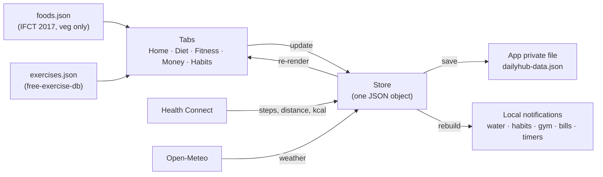

```
Daily_tracker/
├── src/
│   ├── main.js            app shell: tab bar, + button, Android back button
│   ├── store.js           all data, saved to a private file on the phone
│   ├── ui.js              rings, charts, bottom sheets, swipe, toasts, confetti
│   ├── themes.js          8 colour themes and light/dark/black modes
│   ├── styles.css
│   ├── tabs/              one file per screen
│   ├── lib/               maths and phone features (dates, money, diet, gym, reminders, steps, weather)
│   └── data/              generated food and exercise data
├── scripts/               generators for the data files
├── tests/                 unit tests (Vitest)
├── public/                privacy policy, icon
├── android/               the Android project (Capacitor)
└── docs/screenshots/
```

---

## Where the data comes from

| What | Source | Licence / note |
|---|---|---|
| Food nutrition (327 veg foods, per 100 g) | **Indian Food Composition Tables 2017**, National Institute of Nutrition, Hyderabad, via the [`ifct2017`](https://www.npmjs.com/package/ifct2017) npm package | The package is AGPL-3.0. Only its data is used; `scripts/build-foods.mjs` filters out egg, meat and fish groups and converts kJ to kcal. Tests check that every food's energy agrees with its protein, fat and carbs. |
| Exercises (873, with photos and steps) | [free-exercise-db](https://github.com/yuhonas/free-exercise-db) | Public domain (Unlicense). Photos load from jsDelivr when you open them. |
| Daily calorie target | Mifflin-St Jeor equation with an activity factor | An estimate, not medical advice. |
| Gym calories | [Compendium of Physical Activities](https://pacompendium.com/conditioning-exercise), code 02054, resistance training 8-15 reps = **3.5 METs** | kcal = 3.5 × body weight (kg) × hours. |
| Weather | [Open-Meteo](https://open-meteo.com/) | Free, no key. |
| Steps | Android Health Connect | Read only. |
| Quitline number | National Tobacco Quitline Services, Ministry of Health and Family Welfare | 1800-11-2356 |

---

## FAQ

<details>
<summary><b>Steps show 0. What do I do?</b></summary>

Daily Hub only reads what Health Connect has. Open Health Connect (Fitness → Steps → *Steps showing 0?* → Open Health Connect) and check two things: that some app, for example Fitbit or Google Fit, is writing steps into Health Connect, and that Daily Hub has permission to read Steps.
</details>

<details>
<summary><b>Reminders come late or not at all.</b></summary>

1. Settings → Reminders → *Allow exact timing*.
2. Android Settings → Apps → Daily Hub → Battery → set to **Unrestricted**.
3. Make sure the app is not installed in the Private space; Android hides its notifications while the space is locked.
4. Use *Test (in 1 min)* to check.
</details>

<details>
<summary><b>Exercise pictures do not show.</b></summary>

They load from the internet the first time you open them, then the phone caches them. Offline, you see a muscle icon instead. Logging works either way.
</details>

<details>
<summary><b>Why are curd, oats and whey missing from the food list?</b></summary>

They are not in the Indian Food Composition Tables 2017. Add them once under + Add → My foods using the numbers on the packet.
</details>

<details>
<summary><b>How accurate are the calories?</b></summary>

Food values are lab values from IFCT 2017 for the raw food. Your actual cooking (oil, water lost) changes things, so treat totals as a good guide, not an exact count. The calorie target and gym burn are standard estimates.
</details>

<details>
<summary><b>How do I delete everything?</b></summary>

Uninstall the app, or Android Settings → Apps → Daily Hub → Storage → Clear storage.
</details>

---

## Known limits

- No sync between devices. Use backup and restore to move data.
- Health Connect lets an app read about the last 30 days when it first connects. After that, Daily Hub keeps its own copy, so history keeps growing.
- Bill due days are limited to 1 to 28, so every month has that date.
- The APK built with the steps above is a **debug build**. It is fine for personal use but cannot go on the Play Store as it is.
- Tested with unit tests and a headless browser at phone size. Testing on a real phone is still to be done.

---

<div align="center"><sub>Made by Pratham Chudiwal for daily use. Suggestions and issues are welcome.</sub></div>
